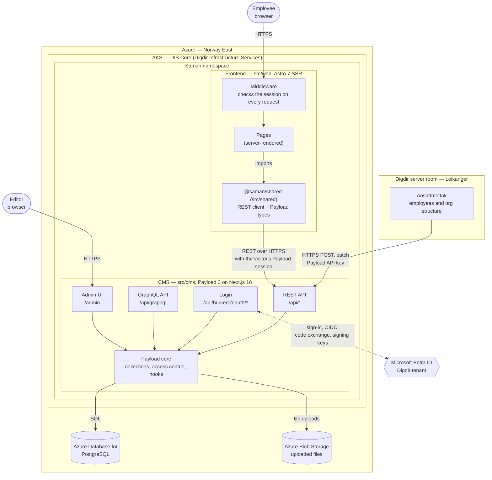

# Architecture overview

Saman replaces baksia.digdir.no as Digdir's internal source for employees, roles
and the organisation structure.

The moving parts of Saman as it is meant to run: in Azure in Norway, with
sign-in through Microsoft Entra ID. Solid arrows are requests. The dotted arrow
is the sign-in with Entra ID: the browser is sent there and back, and the CMS
exchanges the result for a token and checks it against Entra ID's signing keys.

> **Status:** the application code exists and runs locally, including sign-in
> with Entra ID. The Azure hosting is decided but not built yet. See
> [Local development](#local-development) for how this maps to a developer machine
> today.

### Diagram source

The picture above is drawn by hand from the Mermaid diagram below. The Mermaid
diagram is the source of truth: change it first, then redraw
`architecture.svg` to match.

## Parts

| Part | Role |
| --- | --- |
| **DIS Core** | Digdir Infrastructure Services' shared AKS cluster. Saman gets its own namespace there, and both apps run in it. |
| **Frontend** (`src/web`) | The site employees use, running in Saman's namespace on DIS Core. Its middleware checks on every request that the visitor is logged in, and sends everyone else to `/logg-inn`. Astro renders every page on the server and fetches content from the CMS during the request, so the browser never fetches content from the CMS directly. |
| **CMS** (`src/cms`) | Runs in the same namespace as the frontend. Owns the content model, access control and data. It runs the sign-in with Entra ID and issues the session both apps use. Editors work in the admin UI; the frontend reads through the REST API, and Ansattmottak posts employees and the org structure to a custom batch endpoint on it. GraphQL is exposed but nothing uses it yet. CORS and CSRF only allow the frontend's URL. |
| **`@saman/shared`** (`src/shared`) | A pnpm workspace package, not a running service; it is drawn inside the frontend because that is where its code runs. It holds the types generated from the collection configs (`pnpm generate:types`) and a thin REST client, so the frontend is typed against the CMS schema. |
| **Microsoft Entra ID** | Identity provider for both employees and editors, through OpenID Connect against Digdir's tenant. The CMS's login talks to it; the frontend never does. It says who someone is; what they may see and do is managed in Payload. It is a global Microsoft service, so it sits outside the Norway region in the diagram. |
| **Ansattmottak** | The source of employee information and the organisation structure (units). It runs on a server in Digdir's own server room in Leikanger, outside Azure, and posts this data in batches to a custom endpoint on the CMS's API, authenticated with a Payload API key. Saman does not edit this data; it receives it. |
| **Azure Database for PostgreSQL** | The only database. In Azure the schema is applied with migrations, not pushed on startup. |
| **Azure Blob Storage** | Files uploaded to Payload's `media` collection. |

Everything Saman stores — content in PostgreSQL and uploaded files in Blob
Storage — stays in Norway East.

## Authentication

Why it is designed this way is in
[ADR-0001](../adr/0001-login-and-sessions.md).

1. An employee opens the frontend. Its middleware finds no session and sends
   them to `/logg-inn`.
2. «Logg inn med Entra ID» goes to the CMS's login endpoint, which sends the
   browser to Entra ID (authorization code flow with PKCE).
3. Entra ID sends the browser back to the CMS with a code. The CMS exchanges it
   for an ID token, checks the token against Entra ID's signing keys and
   Digdir's tenant, finds or creates the Payload user by the Entra ID account's
   `oid`, and sets Payload's session cookie.
4. On every request the frontend asks the CMS who the session belongs to, and
   fetches content with the same session, sent as `Authorization: JWT`. Payload's
   access control therefore runs as the employee, not as a shared service
   account.
5. Editors log in to the admin panel the same way, with a button on its login
   page. Only administrators use the admin panel. Roles are set on the Payload
   user in the admin, not taken from Entra ID groups.

Payload's own email and password login stays as the fallback for when Entra ID
doesn't work (NF-12). Who may use it is proposed in
[ADR-0002](../adr/0002-password-login-only-for-break-glass-accounts.md).

Ansattmottak is a system, not a person, so it has no Entra ID sign-in. It
authenticates with a Payload API key that belongs to a dedicated integration
user in the CMS. That user's access is limited to the batch endpoint. Payload
encrypts API keys with `PAYLOAD_SECRET`, so changing the secret in an
environment means issuing Ansattmottak a new key.

## Local development

The same application code runs on a developer machine, with local stand-ins
for the Azure services:

| In Azure | Locally |
| --- | --- |
| Azure Database for PostgreSQL | PostgreSQL 17 in Docker on `:5432`, schema pushed on startup |
| Azure Blob Storage | Local disk, `src/cms/media` |
| Entra ID sign-in | The same sign-in, against an app registration with `localhost` redirect URIs (`ENTRA_*` in `src/cms/.env`). Without those settings, only email and password. The tests use a mock provider |
| Ansattmottak | Not available; employees and units have to be seeded or posted by hand |
| Saman namespace on DIS Core | `pnpm dev`: Astro on `:4321`, Payload on `:3000` |

The [agentctl Agent](../../agent/README.md) runs this same local stack inside a
sandbox, with Podman in place of Docker. The [prototype](../../prototype) is a
static HTML spec and is not part of the running system. Its employee data was a
one-time import from baksia.digdir.no to get realistic test data.

## Open questions

- **The network path** from Leikanger to the CMS on DIS Core: over the internet
  through the cluster's ingress, or over a private connection.
- **The batch endpoint's contract**: proposed in
  [ADR-0003](../adr/0003-imports-from-the-authoritative-source.md), starting with
  the [unit import](../integrations/unit-import.md): one endpoint per kind of
  data, a full snapshot in each CSV file, and units missing from the file
  marked as closed.

## Later: public pages

Saman is internal for now: every visitor is an employee who signs in (NF-11).
Public pages may come later; the requirements for them (NF-03, SF-03) are set
to «Ikke nå». Those requests carry no employee token, so the frontend
will need another way to read from the CMS, and the CMS will need access rules
for what anonymous visitors may see. How that works is not decided yet.
