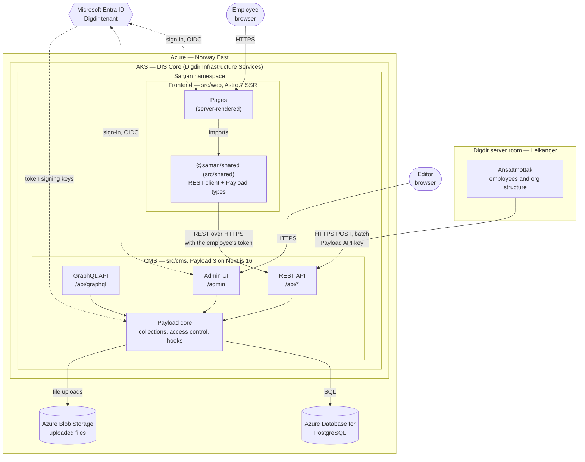

# Architecture overview

Saman replaces baksia.digdir.no as Digdir's internal source for employees, roles
and the organisation structure.

The moving parts of Saman as it is meant to run: in Azure in Norway, with
sign-in through Microsoft Entra ID. Solid arrows are requests; dotted arrows are
sign-in redirects and the signing keys the CMS checks tokens against.

> **Status:** the application code exists and runs locally. Entra ID sign-in and
> the Azure hosting are decided but not built yet. See
> [Local development](#local-development) for how this maps to a developer machine
> today.

### Diagram source

The picture above is drawn by hand from the Mermaid diagram below. The Mermaid
diagram is the source of truth: change it first, then redraw
`architecture.svg` to match.

## Parts

| Part | Role |
| --- | --- |
| **DIS Core** | Digdir Infrastructure Services' shared AKS cluster. Saman gets its own namespace there, and both apps run in it. |
| **Frontend** (`src/web`) | The site employees use, running in Saman's namespace on DIS Core. Astro renders every page on the server and fetches content from the CMS during the request, so the browser never calls the CMS directly. |
| **CMS** (`src/cms`) | Runs in the same namespace as the frontend. Owns the content model, access control and data. Editors work in the admin UI; the frontend reads through the REST API, and Ansattmottak posts employees and the org structure to a custom batch endpoint on it. GraphQL is exposed but nothing uses it yet. CORS and CSRF only allow the frontend's URL. |
| **`@saman/shared`** (`src/shared`) | A pnpm workspace package, not a running service; it is drawn inside the frontend because that is where its code runs. It holds the types generated from the collection configs (`pnpm generate:types`) and a thin REST client, so the frontend is typed against the CMS schema. |
| **Microsoft Entra ID** | Identity provider for both employees and editors, through OpenID Connect against Digdir's tenant. It says who someone is; what editors may do is managed in Payload. It is a global Microsoft service, so it sits outside the Norway region in the diagram. |
| **Ansattmottak** | The source of employee information and the organisation structure (units). It runs on a server in Digdir's own server room in Leikanger, outside Azure, and posts this data in batches to a custom endpoint on the CMS's API, authenticated with a Payload API key. Saman does not edit this data; it receives it. |
| **Azure Database for PostgreSQL** | The only database. In Azure the schema is applied with migrations, not pushed on startup. |
| **Azure Blob Storage** | Files uploaded to Payload's `media` collection. |

Everything Saman stores — content in PostgreSQL and uploaded files in Blob
Storage — stays in Norway East.

## Authentication

1. An employee opens the frontend and is sent to Entra ID to sign in.
2. The frontend gets an access token for the CMS's API, issued for the CMS's own
   app registration, and keeps it in the employee's server-side session.
3. Every request from the frontend to the CMS carries that token. The CMS
   validates it against Entra ID's signing keys and maps it to a Payload user, so
   Payload's access control runs as the employee and not as a shared service
   account.
4. Editors sign in to the Payload admin with the same Entra ID account. Which
   collections they may edit comes from roles on their Payload user, managed in
   the admin, not from Entra ID groups.

The CMS needs a custom Payload auth strategy for steps 3 and 4. Payload's built-in
email and password login is only for local development.

Ansattmottak is a system, not a person, so it has no Entra ID sign-in. It
authenticates with a Payload API key that belongs to a dedicated integration
user in the CMS. That user's access is limited to the batch endpoint. Payload
encrypts API keys with `PAYLOAD_SECRET`, so changing the secret in an
environment means issuing Ansattmottak a new key.

## Local development

The same application code runs on a developer machine, with local stand-ins
for the Azure services:

| In Azure | Locally |
| --- | --- |
| Azure Database for PostgreSQL | PostgreSQL 17 in Docker on `:5432`, schema pushed on startup |
| Azure Blob Storage | Local disk, `src/cms/media` |
| Entra ID sign-in | Not built yet; the admin uses Payload's own email and password users |
| Ansattmottak | Not available; employees and units have to be seeded or posted by hand |
| Saman namespace on DIS Core | `pnpm dev`: Astro on `:4321`, Payload on `:3000` |

The [agentctl Agent](../../agent/README.md) runs this same local stack inside a
sandbox, with Podman in place of Docker. The [prototype](../../prototype) is a
static HTML spec and is not part of the running system. Its employee data was a
one-time import from baksia.digdir.no to get realistic test data.

## Open questions

- **The network path** from Leikanger to the CMS on DIS Core: over the internet
  through the cluster's ingress, or over a private connection.
- **The batch endpoint's contract**: its path and payload, whether each batch is
  a full snapshot or only changes, and how employees who leave and units that
  are closed or merged are handled.

## Later: public pages

Saman is internal for now: every visitor is an employee who signs in. Public
pages will come later. Those requests carry no employee token, so the frontend
will need another way to read from the CMS, and the CMS will need access rules
for what anonymous visitors may see. How that works is not decided yet.
