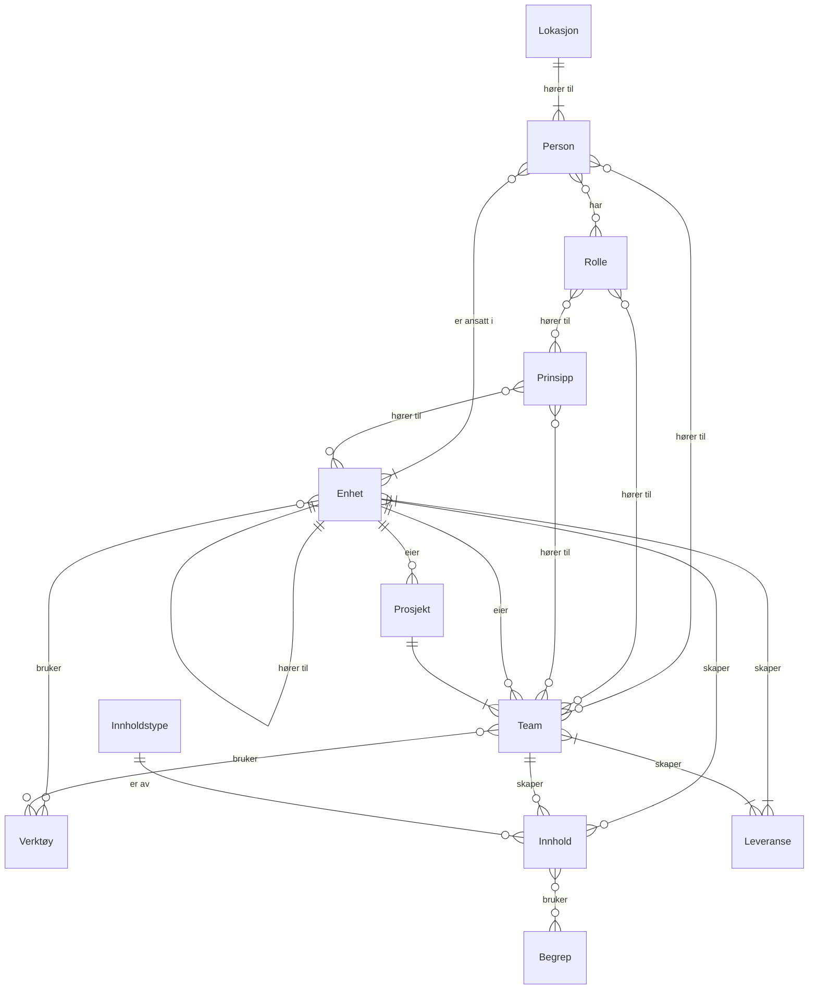

# Saman — Rammeverk for hvordan vi jobber sammen med leveranser

**Kravspesifikasjon**

> Kravspesifikasjonen eies av Organisasjonslæring (VSU) og forvaltes i denne filen. Den beskriver intensjonen bak Saman og er utgangspunktet for implementeringen, og den oppdateres etter hvert som løsningen utvikles. Begrunnelser for endringer står i `docs/specification/decisions.md`. Ved behov for en Word-versjon lages den fra denne filen.

## 1. Innledning
### 1.1 Bakgrunn
I dag er det mange ulike strukturer, prosesser og metoder som påvirker hvordan vi jobber med leveransene i Digdir. Dette mangfoldet gir fleksibilitet, ved at team og enheter står fritt til å velge den arbeidsformen som passer best for oppgaven som skal løses. Samtidig skaper mangfoldet noen ulemper: det kan oppleves uklart hvem som har ansvar for hva, hvordan milepæler og fremdrift følges opp, og hvordan ressurser fordeles. Variasjonen kan også bli så stor at det oppstår et "oversettelsesbehov" mellom team og enheter, som gjør det unødvendig krevende å samarbeide og samordne arbeidet på tvers.

### 1.2 Formål
Hovedleveransen er et rammeverk i form av et digitalt produkt som gjør det enklere å jobbe sammen på tvers: **Saman** – rammeverk for hvordan vi jobber sammen med leveranser. En annen undertittel til Saman kunne like gjerne vært: slik jobber vi sammen i Digdir.

Arbeidet er en del av Digdirs pågående organisasjonsutvikling (OU). Målet med OU-prosessen er at Digdir skal bruke virkemidlene sine mer helhetlig og samtidig styrke organisasjonens endringsevne. Dette rammeverket skal bidra til å nå det målet ved å gi Digdir et operasjonelt rammeverk som gjør det enklere å levere mer samordnet på samfunnsoppdraget.

Saman definerer hva som skal eller bør gjøres likt på tvers av team og enheter som jobber med leveranser - interne eller eksterne - og hva som fortsatt skal være fleksibelt og opp til det enkelte team eller enhet.

### 1.3 Mål og gevinster
- gi alle ansatte et felles språk for hvordan vi jobber med leveranser

- understøtte den kulturen vi ønsker å ha i Digdir

- gi team og enheter tydelig retning, ansvar og mandat

- senke terskelen for samarbeid tvers og øke fleksibiliteten ved at flere jobber på samme måte

- gjøre det lett for alle ansatte å finne frem til hvem som har ansvar for hva gjennom økt synlighet av team/enheter og ansvarsområder

- legge til rette for bedre koordinering mellom team og enheter

- hjelpe nyansatte til å bli kjent med organisasjonen og måten vi jobber på

### 1.4 Omfang og avgrensning
**Saman skal dekke:**

- Beskrivelse av **prinsipper** på ulike nivåer og formål.

- Eksempelvis for ledelse, for etablering av team, for oppfølging av team, og teamenes egne prinsipper. Til sammen skal disse bidra til å forme den kulturen og måte jobbe på Digdir ønsker å ha.

- **Klassifisering av team og enheter** i ulike typer, med kjennetegn som gjør det enklere å forstå hvilken kategori man selv tilhører

- **Rollebeskrivelser og ansvarsfordeling** for roller slik at det blir tydelig hvem som har ansvar for hva

- En **verktøykasse** med anbefalte metoder, maler og verktøy som gir gjenkjennelighet når ansatte beveger seg mellom team og enheter

- En **oversikt over team og enheter** (divisjoner, avdelinger og seksjoner) i Digdir, med tilhørende mandat og ansvarsområder

- Et **felles begrepsapparat** som brukes likt på tvers av Digdir

- En **oversikt over alle ansatte**, deres tilhørighet i linjen, teamene de er med i og hvordan kapasiteten deres er allokert

- En **KI-assistent** som svarer på spørsmål ut fra innholdet i Saman

- **Mål og nøkkelresultater (OKR)** for team og enheter, med status som kan følges samlet i linjen

- En oversikt over **innsatsområder** og teamene som er tilknyttet dem

- Vise, og knytte inn, **Digdirs styringsfundament** (visjon, samfunnsoppdrag, målbilde, verdier, brukergrupper og institusjonelle roller), som en samlet og alltid oppdatert kilde for alle ansatte.

Saman skal være tilgjengelig for alle ansatte i Digdir, uavhengig av om arbeidet er organisert i team eller i linjen.

**Saman skal ikke:**

- Saman skal ikke velge eller pålegge en bestemt arbeidsmetodikk (f.eks. Scrum, Kanban, SAFe) for virksomheten. Rammeverket skal anbefale prinsipper, roller og strukturer som bør være felles, og overlate valg av metodikk til det enkelte team. For å sikre at rammeverket utfordres når det ikke fungerer etter hensikt må det være mulig å velge noe annet. Men da bør læringen gå tilbake i form av oppdaterte beskrivelser og anbefalinger.

- Saman skal ikke detaljstyre hvordan det enkelte team organiserer sitt daglige arbeid, utover det som er nødvendig for å sikre samarbeid og samordning på tvers.

- Med det store mangfoldet av oppgaver og virksomhetsområder i Digdir skal fleksibilitet beholdes der det er mulig og hensiktsmessig – Saman skal legge til rette for en balanse mellom det som må gjøres likt for alle, og det som fortsatt kan variere.

### 1.5 Begreper
For å sikre en felles forståelse gjennom dokumentet, brukes følgende begreper med disse betydningene:

**Rammeverk  
**"Et rammeverk er en overordnet struktur, et sett med regler, retningslinjer eller standarder som brukes som et grunnlag for å bygge eller organisere noe annet."[^1]

Rammeverket, Saman, beskriver hvordan vi i Digdir ønsker å jobbe for best mulig å levere på formålet vårt. Det gir rammer og struktur og er i praksis en verktøykasse for alle i Digdir. Noe MÅ man forholde seg, men i det store handler det om en verktøykasse hvor man velger det verktøyet som passer til formålet.

**Team  
**En gruppe Digdir-medarbeidere (og eventuelt eksterne) som arbeider sammen om leveranser.

**Prosjekt  
**Et prosjekt er en midlertidig organisasjon som er etablert for å levere ett eller flere produkter som bidrar til å realisere en avtalt begrunnelse. Prosjekter har vanligvis et tydelig mål, en avgrenset ramme for tid, kostnad og omfang, og en oppgave som skiller seg fra ordinær drift.[^2]

En gruppe Digdir-medarbeidere (og eventuelt eksterne) som jobber sammen mot leveranser av mer kortvarig karakter, med en tydelig start og stopp.

**Enhet  
**En gruppe Digdir-medarbeidere i linje organisasjonen, det kan være Divisjon, Avdeling eller Seksjon.

**Leveranse**  
Alt som skapes av eller kommer ut av et team eller prosjekt. Kan være et digitalt produkt, en rapport, et arrangement, en prosess, daglig drift etc.

### 1.6 Brukergrupper
Saman henvender seg til alle ansatte og innleide i Digdir, men ulike grupper vil bruke rammeverket til noe ulike formål:

- **Alle ansatte** - for å forstå hvordan organisasjonen henger sammen og hvordan vi ønsker å jobbe sammen, hvem som har ansvar for hva, lære hvordan en selv kan bidra inn i leveranser

- **Nyansatte** - for raskt å bli kjent med hvordan Digdir er organisert og hvordan vi jobber sammen

- **Toppledelsen** - for å sette lederprinsipper og styringsrammer, og synliggjøre beslutninger om organisering

- **Linjeledere/mellomledere** - for å følge opp team og enheter, avklare ansvar og mandat, og koordinere mellom linje og team

- **Teameier** - oversikt over sine team, normalt en linjeleder

- **Teamledere** - for å etablere, følge opp og videreutvikle eget team i tråd med mandat og prinsipper

- **Teammedlemmer** - for å forstå eget teams mandat og forventninger

- **Prosjekteier** - oversikt over sine prosjekt

- **Prosjektleder** - for å etablere prosjektet med medlemmer og mandat

- **Prosjektdeltager** - for å forstå eget prosjektets mandat og leveranse

I tillegg skal deler av rammeverket være tilgjengelig for eksterne brukergrupper som bidrar inn, og samarbeider om, leveranser.

## 2. Systembeskrivelse
### 2.1 Hva er rammeverket
Saman er et digitalt, nettbasert produkt som samler de sentrale funksjonsområdene beskrevet i kapittel 3 på ett sted: teamklassifisering, prinsipper, rollebeskrivelser, verktøykasse, teamoversikt og begreper. Brukeren møter Saman som en veiledningsportal der man kan orientere seg i hvordan Digdir organiserer og jobber med leveranser, uavhengig av om man selv er organisert i team eller i linjen.

Innhold som er spesifikt for et team, prosjekt eller enhet forvaltes desentralisert: ledere kan oppdatere informasjon for sin enhet, prosjektledere for sitt prosjekt, og teamledere for sitt team. Alle medlemmer av et team, prosjekt eller en enhet skal i utgangspunktet kunne redigere innhold på sitt eget område.

### 2.2 Systemkontekst og avhengigheter
Saman inngår i og må sees i sammenheng med følgende:

- **Digdirs styringsfundament** — Saman erstatter ikke styringsfundamentet, men skal integrere dette inn i løsningen og legge til rette for at dette innarbeides.

- **Digdirs nye organisering** — besluttes gjennom den pågående organisasjonsutviklingen (OU), og Saman skal reflektere og understøtte denne.

- **Ressursstyring/porteføljestyring** — Saman viser hvordan den enkelte ansatte er allokert på tvers av team og prosjekter (jf. Allokering), men selve prioriteringen og fordelingen av ressurser håndteres i egne prosesser/systemer for porteføljestyring.

- **Ekstern begrepskatalog (data.norge.no)** — begreper i Saman kan kobles mot denne katalogen (jf. BG-04).

- **Digdirs designsystem** — det visuelle uttrykket i Saman skal følge Digdirs etablerte designsystem.

- **Språkmodell** — KI-assistenten (jf. Spør Saman) forutsetter en ekstern språkmodelltjeneste. Valg av leverandør, databehandleravtale og kostnadsmodell er ikke avklart.

- **HR-system eller Entra ID** — ansatte, enhetstilhørighet og ledere hentes automatisk fra Digdirs autoritative kilde. Hvilken kilde som skal brukes, er ikke avklart (jf. åpen avklaring 6).

- **Analyseverktøy** — bruksmålingen (jf. NF-08) forutsetter et eksternt analyseverktøy. Prototypen bruker PostHog. Leverandør og databehandleravtale er ikke avklart.

### 2.3 Brukerroller
- **Ansatt** — har som utgangspunkt lesetilgang til alt innhold vedkommende har tilgang til (internt eller eksternt), uten å kunne redigere.

- **Enhetsleder** — kan redigere innhold knyttet til sin egen enhet.

- **Prosjektleder** — kan redigere innhold knyttet til sitt eget prosjekt.

- **Teamleder/produkteier** — kan redigere innhold knyttet til sitt eget team.

- **Teammedlem/prosjektdeltaker** — kan redigere innhold knyttet til teamet eller prosjektet vedkommende er medlem av, jf. 2.1.

- **Administrator** — kan opprette og vedlikeholde felles innhold som gjelder på tvers av Digdir (f.eks. teamtyper, verktøytyper, roller, begreper og prinsippområder). Rollen innehas av Organisasjonslæring (VSU).

- **Ekstern bruker** — har lesetilgang til innhold som er gjort tilgjengelig eksternt, uten redigeringsrettigheter.

### 2.4 Overordnede antakelser
- Digdirs styringsfundament og nye organisering vedtas og gjelder som forutsatt gjennom OU-prosessen, og legger rammene Saman skal understøtte.

- Alle ansatte og innleide har tilgang til systemet via eksisterende pålogging/tilgangsstyring i Digdir.

- Team, prosjekter og enheter registrerer og vedlikeholder innholdet om eget område selv, som mandat, prinsipper og OKR (jf. 2.1) — løsningen forutsetter aktiv bruk og oppdatering fra brukerne. Ansatte, enhetstilhørighet og ledere hentes automatisk (jf. 2.2).

- Ekstern begrepskatalog (data.norge.no) er tilgjengelig og kan kobles til fra Saman.

- Organisasjonslæring (VSU) har innholdsmessig eierskap til Saman.

## 3. Funksjonelle krav
> **NB!** De funksjonelle kravene er basert på det innsiktsarbeidet gruppen har gjort gjennom intervjuer, diskusjoner og enkle brukertester. Det er på ingen måte en fasit, og det oppfordres til å starte i det små med en MVP.
>
> De overordnede funksjonelle områdene er det viktigste som er identifisert og diskutert. De konkrete kravene under hvert område er gode eksempler på hva som kan være med, men bør vurderes forløpende ved en implementering.

### 3.1 Teamoversikt
Innsiktsarbeidet viser at mange ikke kjenner til teamene som eksisterer i dag, særlig de som ligger utenfor egen avdeling, og hva de tilbyr. Skal vi klare å utnytte kompetanse i Digdir må vi lære egen organisasjon å kjenne og klare å trekke på kompetansen som allerede finnes i andre team.

Dagens organisasjonskart viser linjeorganisasjonen, men ikke teamene. Ulike oversikter over ulike inndelinger finnes, men de dekker ikke hele organisasjonen og er spredt i forskjellige kanaler (digdir.no, samarbeidsportalen, baksida, mm.).

Temaoversikten kan se ut som en strukturert liste over ulike type støtte som er tilgjengelig for teamene, enten det gjelder programvarer, metoder, arbeidsformer, kompetanse og ferdigheter, samt arenaer og mekanismer for kompetansebygging og støtte.

#### Krav
Teamoversikt skal gi en oversikt over alle team i Digdir, deres leveranser og grunn til å eksistere.

| ID    | Beskrivelse                                                                                                                                                                | Prioritet |
|-------|----------------------------------------------------------------------------------------------------------------------------------------------------------------------------|-----------|
| TO-01 | Systemet skal vise en liste over alle registrerte team i Digdir.                                                                                                           | Må        |
| TO-02 | Systemet skal for hvert team vise hvilken teamtype teamet tilhører.                                                                                                        | Må        |
| TO-03 | Systemet skal for hvert team vise teamets medlemmer og deres roller.                                                                                                       | Må        |
| TO-04 | Systemet skal vise teamets mandat, der dette er registrert.                                                                                                                | Bør       |
| TO-05 | Systemet skal la brukeren søke og filtrere team etter teamtype.                                                                                                            | Bør       |
| TO-06 | Systemet skal la brukeren filtrere team etter medlemmenes lokasjon.                                                                                                        | Kan       |
| TO-07 | Systemet skal vise hvilke verktøy et team bruker, der dette er registrert.                                                                                                 | Kan       |
| TO-08 | Systemet skal la ledere opprette og endre team.                                                                                                                            | Må        |
| TO-09 | Systemet skal la teamet registrere mandatet i faste felter etter Digdirs mandatmal (jf. Vedlegg 3).                                                                        | Må        |
| TO-10 | Systemet skal vise om mandatet er komplett, og hvilke felter som mangler.                                                                                                  | Bør       |
| TO-11 | Systemet skal la teamet registrere teamkontrakten i faste felter etter strukturen i Vedlegg 4.                                                                             | Bør       |
| TO-12 | Systemet skal vise om teamkontrakten er komplett, og hvilke felter som mangler.                                                                                            | Kan       |
| TO-13 | Systemet skal vise feltet «Personlig bruksanvisning» i teamkontrakten bare for teamets medlemmer.                                                                          | Må        |
| TO-14 | Systemet skal la teamet registrere hvilke brukergrupper det leverer til, valgt fra brukergruppene i styringsfundamentet, eller markere at teamet leverer internt i Digdir. | Bør       |
| TO-15 | Systemet skal la brukeren filtrere teamoversikten etter brukergruppe.                                                                                                      | Kan       |

### 3.2 Roller og ansvar (RAMO)
RAMO (Rolle, Ansvar, Myndighet og Oppgaver) er en strukturmodell som gir en tydelig beskrivelse av hva en rolle innebærer. Modellen bidrar til å avklare forventninger, redusere uklarheter og skape et bedre grunnlag for samarbeid og oppgaveløsning. Forkortelsene står for Rolle, Ansvar, Myndighet og Oppgaver.

RAMO kombinerer struktur og menneskelighet. Når rammene er klare, blir det lettere å samarbeide, lettere å bygge tillit og enklere å ta gode beslutninger. Når alle vet hva som forventes av dem (og av andre) skaper det klarhet og tillit og både arbeidsklima og samhandling styrkes. Klare ansvarsrammer gjør at det blir færre misforståelser og bidrar til å redusere overlapping og ansvars gap. For ledere, å vite både hva en er ansvarlig for og hva en har myndighet til skaper også trygghet og handlekraft. Ved rett bruk bidrar RAMO til ryddig organisasjonshåndtering, som underbygning til struktur og styring.

Sentrale roller vil beskrives etter RAMO oppsett og tilhørende HUKI. Samspill mellom de ulike rollene skal ha særskilt fokus. Denne delen av rammeverket ses i sammenheng med beskrivelser av lederroller med personalansvar.

#### Krav
Roller og RAMO skal gi et standardisert og lett tilgjengelig sett med rollebeskrivelser for team- og prosjektarbeid i Digdir, strukturert etter RAMO-modellen.

| ID    | Beskrivelse                                                                                                        | Prioritet |
|-------|--------------------------------------------------------------------------------------------------------------------|-----------|
| RO-01 | Systemet skal vise en liste over definerte roller i Digdir.                                                        | Må        |
| RO-02 | Systemet skal for hver rolle vise beskrivelse strukturert etter RAMO (ansvar, myndighet, oppgaver).                | Må        |
| RO-03 | Systemet skal vise hvilke roller som er relevante for de ulike teamtypene.                                         | Må        |
| RO-04 | Systemet skal la brukeren søke og filtrere roller etter teamtype.                                                  | Kan       |
| RO-05 | Systemet skal, i teamoversikten, vise hvilke medlemmer som har en gitt rolle i et team.                            | Må        |
| RO-06 | Systemet skal la en teamleder registrere eller oppdatere hvilken rolle et medlem har i teamet.                     | Må        |
| RO-07 | Systemet skal la administrator opprette nye roller ved behov. Fra start skal det ligge inne teamleder og teameier. | Må        |

### 3.3 Veiviser/klassifisering
Veiviseren fungerer som en navigator for etablering av nye team, og som et verktøy for pulsmåling og refleksjon i eksisterende team.

En sjekkliste som støtter team i å avklare mandat, teamtype, roller, arbeidsformer, verktøy og grenseflater mot andre team.

For at en veiviser skal ha verdi over tid, må den kunne brukes på tvers av team og roller, ved flere anledninger, og gi konkret støtte i praktiske beslutninger og ansvar.

Det kan ser ut som en enkle sorteringsspørsmål som gir en rask vurdering av hvilken teamtype som passer best til oppgaven. Valgt teamtype påvirker hvilke prinsipper, roller, verktøy og veivisere som anbefales videre.

#### Krav
Teamklassifisering skal hjelpe brukeren med å identifisere riktig teamtype for et team, og gjøre denne klassifiseringen synlig og gjenfinnbar i systemet.

| ID    | Beskrivelse                                                                                                                                       | Prioritet |
|-------|---------------------------------------------------------------------------------------------------------------------------------------------------|-----------|
| TK-01 | Systemet skal vise en liste over definerte teamtyper (prosjektteam, støtteteam, leveranseteam, produktteam, fagnettverk) med kjennetegn for hver. | Må        |
| TK-02 | Systemet skal la brukeren registrere hvilken teamtype et team tilhører.                                                                           | Må        |
| TK-03 | Systemet skal veilede brukeren gjennom beslutningskriteriene (jf. Vedlegg 1) for å komme frem til riktig teamtype.                                | Bør       |
| TK-04 | Systemet skal, for en valgt teamtype, vise hvilke krav som gjelder til mandat og teamkontrakt.                                                    | Bør       |
| TK-05 | Systemet skal la brukeren endre en registrert teamtype dersom forutsetningene for teamet endrer seg.                                              | Kan       |

### 3.4 Verktøykasse
En felles verktøykasse samler metode, rammeverk, tekniske verktøy, maler, beste praksis etc. Den gir team enkel tilgang til relevante arbeidsformer, kompetansetiltak og praktiske verktøy som styrker både leveranseevne og samarbeid.

Verktøykassen skal bidra til et felles språk, mer effektiv samhandling på tvers av team og bedre utnyttelse av kunnskap, erfaringer og beste praksis på tvers av virksomheten.

Målet er å gjøre det enklere å ta gode valg, redusere unødvendig variasjon og legge til rette for læring, gjenbruk og kontinuerlig forbedring. Slik styrker verktøykassen både teamenes evne til å levere og organisasjonens evne til å skape verdi for brukere og samfunn.

#### Krav
Verktøykasse skal gi et samlet og filtrerbart bibliotek over anbefalte metoder, maler og verktøy for team- og prosjektarbeid i Digdir.

| ID    | Beskrivelse                                                                                                       | Prioritet |
|-------|-------------------------------------------------------------------------------------------------------------------|-----------|
| VK-01 | Systemet skal vise en liste over registrerte verktøy i verktøykassen.                                             | Må        |
| VK-02 | Systemet skal for hvert verktøy vise hvilken verktøytype det tilhører.                                            | Må        |
| VK-03 | Systemet skal for hvert verktøy vise en kort beskrivelse og formål.                                               | Må        |
| VK-04 | Systemet skal la brukeren søke og filtrere verktøy etter verktøytype.                                             | Bør       |
| VK-05 | Systemet skal la brukeren filtrere verktøy etter teamtype.                                                        | Kan       |
| VK-06 | Systemet skal la en teamleder registrere hvilke verktøy teamet bruker.                                            | Må        |
| VK-07 | Systemet skal lenke til eksterne ressurser for verktøyet for mer detaljerte beskrivelser og anbefalinger om bruk. | Bør       |
| VK-08 | Systemet skal lenke til faktiske verktøy der Digdir har lisens.                                                   | Må        |

### 3.5 Begreper
Med felles begreper mener vi en forståelse av sentrale roller, konsepter og uttrykk knyttet til team, styring, ansvar og leveranser. Målet er ikke at alle skal bruke identisk språk, men at organisasjonen har et felles referansepunkt/ ordbok som tydeliggjør hva vi legger i de viktigste begrepene.

Behovet er tydelig. Flere beskriver at samme rolle eller samme type funksjon omtales med ulike navn, og at det samme begrepet kan forstås ulikt fra miljø til miljø. Det skaper misforståelser, unødvendig tidsbruk på å spørre hva den andre mener, og mye kontinuerlig oversettelsesarbeid mellom team og fagområder.

Tydeligere og bedre definerte begreper vil derfor bidra til mer presis kommunikasjon, mindre friksjon i samarbeid og bedre orden i eget hus. Gevinsten er å gjøre det enklere å snakke sammen på tvers av team, mindre tid brukt på begrepsavklaringer og mer tid brukt på verdiskaping.

Som løsning anbefales en levende begrepskatalog med korte og tydelige definisjoner av sentrale begreper, roller og arbeidsformer. Katalogen bør være lett tilgjengelig, aktivt forvaltet og bygge på eksisterende kilder og definisjoner der dette finnes. Hvert begrep bør beskrives med definisjon, praktiske eksempler og eventuelle grensetilfeller, slik at katalogen fungerer som et praktisk arbeidsverktøy og ikke bare som dokumentasjon (eksempelvis [begreper i produktorganisering](https://miro.com/app/board/uXjVGwIEOOE=/?moveToWidget=3458764674230207961&cot=14) fra Digdirs veileder og [begrepskatalogen på data.norge.no](https://data.norge.no/nb/docs/catalogs/concepts), mfl.).

#### Krav
Begreper skal gi et samlet og søkbart begrepsapparat for team- og leveransearbeid i Digdir, med kobling mot [begrepskatalogen på data.norge.no.](https://data.norge.no/nb/docs/catalogs/concepts)

| ID    | Beskrivelse                                                                                                                          | Prioritet |
|-------|--------------------------------------------------------------------------------------------------------------------------------------|-----------|
| BG-01 | Systemet skal vise en liste over definerte begreper.                                                                                 | Må        |
| BG-02 | Systemet skal for hvert begrep vise navn og beskrivelse.                                                                             | Må        |
| BG-03 | Systemet skal la brukeren søke i begrepslisten.                                                                                      | Bør       |
| BG-04 | Systemet skal vise kobling til begrepet i en ekstern begrepskatalog (f.eks. data.norge.no), der dette finnes.                        | Bør       |
| BG-05 | Systemet skal vise ytterligere metadata for begrepet utover beskrivelsen, der dette er registrert.                                   | Kan       |
| BG-06 | Systemet skal, der alle begreper brukes, gi brukeren en «inline» forklaring uten at brukeren må forlate siden/konteksten man står i. | Må        |

### 3.6 Prinsipper
Prinsipper beskriver de grunnleggende føringene for hvordan vi organiserer team, følger dem opp og hvilke rammer teamet skal forholde seg til. De gir teamene et felles utgangspunkt for prioriteringer, beslutninger og samarbeid.

I dag varierer prinsippene mellom ulike team. Dette kan føre til unødvendige forskjeller i arbeidsmåter, uklarhet om forventninger og økt behov for koordinering på tvers av team. Når team forholder seg til ulike grunnleggende premisser, blir samarbeid mer krevende og mindre effektivt.

Felles prinsipper bidrar til større grad av forutsigbarhet, enklere samhandling og en mer helhetlig organisasjonskultur. Prinsippene gir oss et felles utgangspunkt og felles grunn for diskusjoner og er med på å sikre bærekraftige og høyt presterende team over tid.

Prinsippene skal fungere som et felles referansepunkt for organisasjonen og legge til rette for bærekraftige, velfungerende og høyt presterende team over tid.

Løsningen kan være en samlet oversikt over organisasjonens prinsipper, med tydelige beskrivelser av hva hvert prinsipp innebærer, hvorfor det er etablert og hvilken effekt det skal bidra til å oppnå.

#### Krav
Prinsipper skal gi et samlet sted for prinsipper som skal bidra til å forme kulturen og måten å jobbe på i Digdir. Hvert prinsipp skal kunne knyttes til et område, for eksempel arkitekturprinsipper, lederprinsipper, eller et spesifikt team, enhet eller prosjekt.

| ID    | Beskrivelse                                                                                                                                | Prioritet |
|-------|--------------------------------------------------------------------------------------------------------------------------------------------|-----------|
| PR-01 | Systemet skal vise en liste over registrerte prinsipper.                                                                                   | Må        |
| PR-02 | Systemet skal for hvert prinsipp vise hvilket område prinsippet tilhører.                                                                  | Må        |
| PR-03 | Systemet skal la brukeren søke og filtrere prinsipper etter område.                                                                        | Bør       |
| PR-04 | Systemet skal la et team, en enhet eller et prosjekt knytte egne prinsipper til seg selv.                                                  | Kan       |
| PR-05 | Systemet skal vise prinsipper knyttet til et gitt team, enhet eller prosjekt sammen med dets øvrige informasjon (f.eks. i Teamoversikten). | Bør       |
| PR-06 | Systemet skal la brukeren definere hvilke områder prinsipper skal kunne knyttes til (eks. lederprinsipper, arkitekturprinsipper)           | Må        |

### 3.7 Styringsfundament
Digdirs styringsfundament er en samlet fremstilling av virksomhetens visjon, samfunnsoppdrag, målbilde, verdier, brukergrupper og institusjonelle roller. Det er én av tre MVP-er fra arbeidspakken "Digdirs styringsfundament" i OU-prosessen — de to andre (styringsstruktur og styringsprinsipper) er hovedsakelig til bruk for andre OU-kjerneteam, og planlegges tatt inn i Saman på et senere tidspunkt.

#### Krav
Styringsfundament skal gi alle ansatte en samlet og alltid oppdatert kilde til Digdirs visjon, samfunnsoppdrag, målbilde, verdier, brukergrupper og institusjonelle roller.

| ID    | Beskrivelse                                                                                                                                                                             | Prioritet |
|-------|-----------------------------------------------------------------------------------------------------------------------------------------------------------------------------------------|-----------|
| SF-01 | Systemet skal vise Digdirs styringsfundament (visjon, samfunnsoppdrag, målbilde, verdier, brukergrupper og institusjonelle roller) samlet på én side.                                   | Må        |
| SF-02 | Systemet skal la en administrator oppdatere innholdet i styringsfundamentet.                                                                                                            | Må        |
| SF-03 | Systemet skal vise styringsfundamentet også for eksterne interessenter, uten innlogging.                                                                                                | Bør       |
| SF-04 | Systemet skal la brukeren navigere til styringsfundamentet fra andre relevante steder i systemet (f.eks. Prinsipper), der det er naturlig å vise sammenheng med overordnede ambisjoner. | Kan       |
| SF-05 | Systemet skal vise historikk over tidligere versjoner av styringsfundamentet, inkludert tidspunkt for endring.                                                                          | Bør       |

### 3.8 Folk
Mange vet ikke hvem kollegene er, hvilken enhet de hører til eller hvilke team de er med i.

Folk gir en samlet oversikt over alle ansatte, deres tilhørighet i linjen og teamene og prosjektene de er med i. Oversikten gjør det enklere å finne riktig person. Hvordan den enkeltes kapasitet er fordelt, beskrives i 3.9 Allokering.

#### Krav
Folk skal gi en samlet oversikt over alle ansatte og deres tilhørighet i linjen og i team.

| ID    | Beskrivelse                                                                                              | Prioritet |
|-------|----------------------------------------------------------------------------------------------------------|-----------|
| FO-01 | Systemet skal vise en liste over alle ansatte i Digdir med navn og rolle.                                | Må        |
| FO-02 | Systemet skal for hver ansatt vise enhet i linjen og hvilke team og prosjekter vedkommende er medlem av. | Må        |
| FO-03 | Systemet skal la brukeren søke etter ansatte på navn, rolle, enhet eller team.                           | Bør       |

### 3.9 Allokering
Når samme person er med i flere team og prosjekter, er det ikke synlig hvor mye av kapasiteten som er bundet opp hvor.

Allokering viser hvordan den enkeltes kapasitet er fordelt på team og prosjekter, og gjør det mulig å se når noen er over- eller underallokert. Allokering er opplysninger om den enkelte ansatte, og bare de som har behov for dem skal se dem (AL-04). Visningen krever personvernvurdering før den tas i bruk (jf. åpen avklaring 3).

#### Krav
Allokering skal vise hvordan den enkelte ansattes kapasitet er fordelt på team og prosjekter, for dem som har behov for å se det.

| ID    | Beskrivelse                                                                                                                    | Prioritet |
|-------|--------------------------------------------------------------------------------------------------------------------------------|-----------|
| AL-01 | Systemet skal vise hvor stor andel av den ansattes kapasitet som er allokert til hvert team og prosjekt, og samlet allokering. | Bør       |
| AL-02 | Systemet skal la teamleder registrere allokering for teamets medlemmer.                                                        | Bør       |
| AL-03 | Systemet skal markere ansatte med samlet allokering under 80 % eller over 100 %.                                               | Kan       |
| AL-04 | Systemet skal begrense visning av allokering til den ansatte selv, teamleder, teameier og personalleder.                       | Må        |

### 3.10 Spør Saman (KI-assistent)
Rammeverket samler mye innhold på ett sted: roller, teamtyper, prinsipper, verktøy, begreper og organisasjonen. Brukerne kommer ofte med et konkret spørsmål, for eksempel hvem som bør være teameier for et nytt team eller hvilken teamtype som passer en oppgave, og må i dag sette sammen svaret fra flere sider selv.

En KI-assistent kan gi svar i kontekst, basert på innholdet i Saman, og vise hvor svaret kommer fra slik at brukeren kan kontrollere det.

#### Krav
Spør Saman skal gi brukerne svar på spørsmål om hvordan vi jobber sammen i Digdir, basert på innholdet i Saman og med tydelig kildehenvisning.

| ID    | Beskrivelse                                                                                                                      | Prioritet |
|-------|----------------------------------------------------------------------------------------------------------------------------------|-----------|
| AI-01 | Systemet skal la brukeren stille spørsmål i naturlig språk om innholdet i Saman og få svar.                                      | Bør       |
| AI-02 | Svarene skal bygge på innholdet i Saman og vise hvilke sider eller elementer svaret er basert på.                                | Må        |
| AI-03 | Assistenten skal bare bruke innhold brukeren selv har tilgang til, og skal ikke gi ut allokeringsdata utover det AL-04 tillater. | Må        |
| AI-04 | Systemet skal tydelig opplyse om at svarene er generert av KI og kan inneholde feil.                                             | Må        |
| AI-05 | Assistenten skal foreslå relevante spørsmål ut fra siden brukeren står på.                                                       | Kan       |
| AI-06 | Systemet skal la administrator slå assistenten av og på uten at resten av løsningen påvirkes.                                    | Bør       |

### 3.11 Mål og nøkkelresultater (OKR)
OKR er et målstyringsverktøy som hjelper team og enheter å holde fokus på effekten de ønsker å oppnå, og hvordan de vet om de lykkes (jf. Vedlegg 5). I dag ligger OKR spredt i ulike dokumenter og verktøy, og det er vanskelig å se hvordan teamenes mål henger sammen med enhetenes mål.

Når OKR registreres og følges opp i Saman, blir målene synlige på tvers, og det blir lettere å holde dem levende gjennom tertialet i stedet for at de havner i skuffen. Confidence på nøkkelresultatene gir et raskt bilde av hvor det går bra og hvor det trengs hjelp.

#### Krav
OKR skal gjøre mål og nøkkelresultater for team og enheter synlige, og gi et samlet bilde av status oppover i linjen.

| ID    | Beskrivelse                                                                                                          | Prioritet |
|-------|----------------------------------------------------------------------------------------------------------------------|-----------|
| OK-01 | Systemet skal la team og enheter registrere mål (objectives) og nøkkelresultater per tertial.                        | Må        |
| OK-02 | Systemet skal vise teamets og enhetens OKR på team- og enhetssiden.                                                  | Må        |
| OK-03 | Systemet skal la teamet registrere og oppdatere confidence for hvert nøkkelresultat.                                 | Bør       |
| OK-04 | Systemet skal beregne og vise Net Confidence Score (andel på sporet minus andel utenfor sporet) for team og enheter. | Bør       |
| OK-05 | Systemet skal aggregere Net Confidence Score for en enhet, inkludert underenheter og tilknyttede team.               | Bør       |
| OK-06 | Systemet skal la team knyttes til én eller flere enheter, som grunnlag for aggregering.                              | Bør       |
| OK-07 | Systemet skal vise samlet OKR-status på forsiden og i organisasjonskartet.                                           | Kan       |
| OK-08 | Systemet skal bare la teamets egne medlemmer endre teamets confidence.                                               | Må        |

### 3.12 Linjeorganisasjon
Med ny organisering av Digdir får mange ansatte ny enhet, ny leder og nye kolleger. Det er behov for et oppdatert organisasjonskart som viser hvilke enheter som finnes, hva de har ansvar for, hvem som leder dem og hvem som jobber der, og hvordan linjen henger sammen med teamene.

Enhetssidene samler denne informasjonen, og enhetsleder vedlikeholder den selv. Direktøren har en egen side som presenterer direktøren, direktørens ansvar og toppledergruppens rolle.

#### Krav
Linjeorganisasjon skal gi alle ansatte en oppdatert oversikt over Digdirs enheter, deres mandat, ledere og ansatte, og hvordan enhetene henger sammen med teamene.

| ID    | Beskrivelse                                                                                                                  | Prioritet |
|-------|------------------------------------------------------------------------------------------------------------------------------|-----------|
| LO-01 | Systemet skal vise et organisasjonskart over Digdirs linjeorganisasjon med divisjoner, avdelinger og seksjoner.              | Må        |
| LO-02 | Systemet skal ha en side per enhet som viser mandat, leder med kontaktinformasjon, ansatte og underenheter.                  | Må        |
| LO-03 | Systemet skal la enhetsleder redigere mandat og øvrig innhold for egen enhet.                                                | Må        |
| LO-04 | Systemet skal vise status for enhetens mandat, for eksempel førsteutkast eller ikke komplett.                                | Bør       |
| LO-05 | Systemet skal la brukeren navigere fra organisasjonskartet til enhetssider og videre til teamene som er knyttet til enheten. | Bør       |
| LO-06 | Systemet skal markere enheter som bistår og rådgir hele Digdir, ikke bare egen divisjon.                                     | Kan       |
| LO-07 | Systemet skal ha en egen side for direktøren med presentasjon, direktørens ansvar og lenker til aktuelle opptak og nyheter.  | Bør       |
| LO-08 | Systemet skal la administrator oppdatere innholdet på direktørsiden.                                                         | Må        |

### 3.13 Innsatsområder
Digdir skal ha innsatsområder på tvers av linjeorganisasjonen: strategiske satsinger som krever helhetlig og tverrgående styring av mål, effekter, virkemidler og ressursprioriteringer. Et innsatsområde koordineres av en områdeansvarlig, som får kapasitet fra relevante team etter avtale med teameierne. Innsatsområder evalueres årlig og avvikles eller overføres til linjen når effekten er nådd.

For at ansatte og ledere skal forstå hvordan arbeidet henger sammen, må det være synlig hvilke innsatsområder som finnes, hvem som leder dem og hvilke team som bidrar. Modellen for innsatsområder er ikke ferdig besluttet, og kravene må justeres når den er det.

#### Krav
Innsatsområder skal gi en oversikt over Digdirs innsatsområder, hvem som leder dem og hvilke team som er tilknyttet.

| ID    | Beskrivelse                                                                                    | Prioritet |
|-------|------------------------------------------------------------------------------------------------|-----------|
| IO-01 | Systemet skal vise en oversikt over Digdirs innsatsområder med formål, mål og områdeansvarlig. | Bør       |
| IO-02 | Systemet skal vise hvilke team som er tilknyttet hvert innsatsområde.                          | Bør       |
| IO-03 | Systemet skal la team knyttes til ett eller flere innsatsområder.                              | Bør       |
| IO-04 | Systemet skal vise hvilke innsatsområder et team er tilknyttet på teamsiden.                   | Kan       |
| IO-05 | Systemet skal vise innsatsområdets mål og nøkkelresultater (OKR).                              | Kan       |
| IO-06 | Systemet skal la administrator opprette, endre og avvikle innsatsområder.                      | Bør       |

### 3.14 Porteføljestyring
Toppledergruppen er Digdirs porteføljestyre, og beslutter strategisk retning og prioriteringer. Saman skal ha et eget funksjonsområde for porteføljestyring, men modellen for porteføljestyring i Digdir er fortsatt under utarbeidelse.

Detaljerte krav avventes til det er avklart hva funksjonsområdet skal inneholde (jf. åpen avklaring 5).

### 3.15 Forside
Forsiden er inngangen til Saman for alle ansatte. Den skal gjøre det enkelt å finne en kollega, et team eller en enhet, og lede nye brukere til det som er mest nyttig å starte med.

Forsiden samler også innhold fra resten av Saman, som dagens begrep, status for OKR og det som er nytt, slik at rammeverket oppleves som levende og verdt å komme tilbake til.

#### Krav
Forsiden skal gi en enkel inngang til Saman, med samlet søk og snarveier til det viktigste.

| ID    | Beskrivelse                                                                                                      | Prioritet |
|-------|------------------------------------------------------------------------------------------------------------------|-----------|
| FS-01 | Systemet skal ha et samlet søk på forsiden etter personer, team, enheter og innhold.                             | Bør       |
| FS-02 | Systemet skal ha en inngang for nyansatte som leder til organisasjonen og begrepene.                             | Bør       |
| FS-03 | Systemet skal ha en inngang til veiviseren for dem som skal etablere et team.                                    | Bør       |
| FS-04 | Systemet skal vise et nytt begrep fra begrepslisten hver dag.                                                    | Kan       |
| FS-05 | Systemet skal vise verktøy som nylig er lagt til i verktøykassen.                                                | Kan       |
| FS-06 | Systemet skal vise en oversikt over de siste endringene i innholdet i Saman.                                     | Kan       |
| FS-07 | Systemet skal minne team og enheter om å oppdatere confidence og sette nye OKR når tertialet nærmer seg slutten. | Kan       |

### 3.16 Tilbakemeldinger
Rammeverket skal utvikles sammen med dem som bruker det. Når noe er feil, utdatert eller uklart, eller når rammeverket ikke fungerer etter hensikten, må læringen gå tilbake til dem som eier innholdet (jf. Omfang og avgrensning).

Tilbakemeldinger gjør det enkelt å melde fra der man står, og gir eierne av innholdet et samlet bilde av hva som må rettes.

#### Krav
Tilbakemeldinger skal gjøre det enkelt å melde fra om feil og mangler, og sikre at innmeldingen når den som eier innholdet.

| ID    | Beskrivelse                                                                                                                                                                       | Prioritet |
|-------|-----------------------------------------------------------------------------------------------------------------------------------------------------------------------------------|-----------|
| TB-01 | Systemet skal la brukeren melde inn feil og mangler fra hver side, med kategori (faktafeil, utdatert, uklart, mangler, annet).                                                    | Bør       |
| TB-02 | Systemet skal sende tilbakemeldingen til den som eier innholdet: teamleder for teamets innhold, enhetsleder for enhetens innhold og Organisasjonslæring (VSU) for felles innhold. | Bør       |
| TB-03 | Systemet skal la eieren av innholdet sette status på tilbakemeldingen (ny, under arbeid, rettet, avvist).                                                                         | Kan       |
| TB-04 | Systemet skal vise en oversikt over innmeldte tilbakemeldinger og status, åpen for alle ansatte.                                                                                  | Kan       |

## 4. Informasjonsmodell
### 4.1 Entiteter
Aktuelle entiteter systemet skal håndtere. Listen er ikke nødvendigvis komplett, men understøtter kravene og funksjonaliteten diskutert så langt.

- **Team** – jobber sammen om leveranser. Kan være produktteam, prosjektteam, støtteteam etc.

- **Enhet** – gruppe i linjeorganisasjonen (divisjon/avdeling/seksjon)

- **Person** – ansatt eller innleid i Digdir som inngår i ett eller flere team, prosjekter eller enheter, tilknyttet én lokasjon. Personen er merket som ansatt eller innleid, og som aktiv eller sluttet. Opplysningene hentes fra Digdirs autoritative kilde (jf. NF-07).

- **Rolle** – funksjon en person har, inkludert navn og beskrivelse (f.eks. teamleder, produkteier, prosjektleder, prosjektdeltager)

- **Prosjekt** – definisjonen av et prosjekt med navn, mandat, start-/sluttdato etc. Kan ha et eller flere team tilknyttet.

- **Leveranse** – det som skapes av et team eller prosjekt

- **Verktøy** – metode, mal eller verktøy fra verktøykassen

- **Prinsipp** – kan knyttes til et område (generell kategori, f.eks. arkitektur eller ledelse) og/eller til en spesifikk enhet, et prosjekt eller et team

- **Begrep** – definert begrep fra begrepsapparatet, med mulig kobling mot ekstern begrepskatalog (data.norge.no) og egne metadata utover beskrivelsen

- **Innhold** – tekstinnhold av en definert type knyttet til team eller prosjekt, f.eks. mandat

- **Lokasjon** – kontor i en by som en person hører til, med kode og navn fra Digdirs autoritative kilde (jf. NF-07)

- **Innholdstype** – definert type innhold f eks mandat og strategi

### 4.2 Logisk datamodell
Den logiske datamodell viser entitetene og relasjonene imellom dem, samt hva relasjonen er.

## 5. Ikke funksjonelle krav
| ID    | Beskrivelse                                                                                                                     | Prioritet |
|-------|---------------------------------------------------------------------------------------------------------------------------------|-----------|
| NF-01 | Løsningen skal være universelt utformet i tråd med WCAG 2.1 nivå AA.                                                            | Må        |
| NF-02 | Løsningen skal bruke Digdirs eksisterende innloggingsløsning for autentisering av interne brukere.                              | Må        |
| NF-03 | Eksterne brukere skal kunne se innhold som er gjort tilgjengelig eksternt, uten innlogging.                                     | Må        |
| NF-04 | Brukergrensesnittet skal følge Digdirs designsystem.                                                                            | Må        |
| NF-05 | Løsningen skal være tilgjengelig for alle ansatte og innleide i Digdir, uavhengig av lokasjon og enhet.                         | Må        |
| NF-06 | Innhold skal kunne opprettes og redigeres av brukere uten teknisk bakgrunn, uten behov for opplæring i koding eller markup.     | Bør       |
| NF-07 | Løsningen skal hente ansatte, enhetstilhørighet og ledere automatisk fra Digdirs autoritative kilde (HR-system eller Entra ID). | Må        |
| NF-08 | Løsningen skal kunne måle bruken av sidene, for å forbedre innholdet og løsningen.                                              | Bør       |
| NF-09 | Bruksmålingen skal ikke sende personopplysninger om andre ansatte, som navn på personer brukeren har slått opp.                 | Må        |
| NF-10 | Når brukeren avslår informasjonskapsler, skal bruksmålingen være anonym og uten identifikatorer.                                | Må        |

## 6. Prioritering (MoScoW)
Kravene i kapittel 3 prioriteres etter MoSCoW-metoden: **M**ust have, **S**hould have, **C**ould have, **W**on't have (this time) — på norsk henholdsvis **Må** ha, **Bør** ha, **Kan** ha, og **Ikke nå**. De tre første brukes som prioritet i kravtabellene; "Won't"/"Ikke nå" brukes ved behov for å synliggjøre krav som er vurdert, men bevisst utsatt.

De funksjonelle områdene i kapittel 3 er satt i prioritert rekkefølge.

## Åpne avklaringer
Punkter som er identifisert underveis, men som krever avklaring med flere enn kjerneteamet før de kan besluttes.

| #   | Tema                                                | Beskrivelse                                                                                                                                                                                                                                                                          | Diskuteres med                      |
|-----|-----------------------------------------------------|--------------------------------------------------------------------------------------------------------------------------------------------------------------------------------------------------------------------------------------------------------------------------------------|-------------------------------------|
| 1   | Navngiving av person-entitet                        | Avklart 2026-10-31: ansatte og innleide modelleres som én entitet, Person, med et flagg for om personen er ansatt (jf. 4.1). Opprinnelig spørsmål: Bør Medlem, Ansatt og eksterne/innleide modelleres som én generisk entitet (der relasjonsnavnet varierer: «ansatt i» Enhet, «medlem av» Team/Prosjekt), eller som separate entiteter (f.eks. Ansatt + Ekstern ressurs)? Påvirker hvordan eksterne/innleide håndteres i datamodellen. | TBD                                 |
| 2   | Teknisk forvaltning og videreutvikling              | Hvem har ansvar for drift, oppdateringer og feilretting fra 1.1.27, når det ikke er etablert et dedikert team?                                                                                                                                                                       | TBD                                 |
| 3   | Personvern ved visning av allokering og bruksmåling | Visning av allokering per ansatt (jf. Allokering) og måling av bruk (jf. NF-08 til NF-10) krever personvernvurdering og avklaring av medvirkning fra tillitsvalgte før funksjonene tas i bruk.                                                                                       | Personvernombud, tillitsvalgte      |
| 4   | Språkmodell for KI-assistenten                      | Hvilken språkmodelltjeneste skal Spør Saman bruke, og hvordan sikres databehandleravtale, personvern og en akseptabel kostnadsmodell?                                                                                                                                                | TBD                                 |
| 5   | Innhold i Porteføljestyring                         | Hva skal funksjonsområdet Porteføljestyring inneholde: forklaring av porteføljestyringen, oversikt over porteføljen, støtte for prioriteringsprosessen, eller en kombinasjon? Støtte for prioriteringsprosessen vil kreve endring i 2.2.                                             | Arbeidspakken for porteføljestyring |
| 6   | Kilde for ansatte og enheter                        | Skal ansatte, enhetstilhørighet og ledere hentes fra HR-systemet eller fra Entra ID? Valget påvirker datakvalitet, hvor raskt endringer blir synlige og hvilke opplysninger som er tilgjengelige.                                                                                    | TBD                                 |
| 7   | Varig ID for personer                               | Personer kobles mot kilden med kildens egen ID. Det er ikke avklart om ID-en er den samme når en innleid blir ansatt. Endres den, blir personen registrert to ganger, og teamhistorikken følger ikke med. | TBD                                 |

## Vedlegg 1: Klassifisering av team (team veiviser)
### Egner oppgaven seg for teamarbeid?
Team er en egnet arbeidsform når oppgaven løses bedre gjennom tett samarbeid og felles ansvar enn ved at enkeltpersoner arbeider hver for seg og koordinerer ved behov.

Vurder:

- Krever oppgaven at flere personer samarbeider tett for å lykkes?

- Er personene gjensidig avhengige av hverandres arbeid, kompetanse eller perspektiver?

- Har de et felles mål eller resultat som de sammen kan ta ansvar for?

- Krever oppgaven løpende koordinering, problemløsning eller prioritering?

- Er det en fordel at de som utfører arbeidet lærer, tilpasser seg og tar beslutninger sammen?

**Hovedsakelig ja:** Oppgaven kan egne seg godt for teamarbeid. Gå videre og vurder hva slags team som trengs.

**Hovedsakelig nei:** Det er ikke sikkert team er den mest hensiktsmessige arbeidsformen. Vurder om oppgaven kan løses gjennom individuelt ansvar, enklere koordinering i linjen eller som et fagnettverk.

### Har oppgaven en definert avslutning?
Når oppgaven egner seg for teamarbeid, er neste spørsmål **hva slags tidsperspektiv oppgaven har**. Noen oppgaver har et tydelig sluttpunkt, mens andre krever et kontinuerlig ansvar over tid.

Vurder:

- Skal teamet nå et definert mål eller levere et bestemt resultat?

- Er det mulig å si når oppgaven er ferdig?

- Kan teamet oppløses når målet eller resultatet er nådd?

**Ja – oppgaven har en definert avslutning:**  
Teamet etableres for å løse en avgrenset oppgave og kan oppløses når den er løst.  
→ Vurder **prosjektteam**

**Nei – oppgaven krever kontinuerlig ansvar:**  
Det vil fortsatt være behov for å utvikle, forvalte, forbedre eller levere noe over tid.  
→ Gå videre og vurder hvordan et **varig team** bør innrettes.

### Hvem skal teamet først og fremst skape verdi for?
Når oppgaven krever et varig team, er neste spørsmål **hvem teamet primært skal skape verdi for**.

**Primært utenfor Digdir**  
Teamets arbeid er først og fremst rettet mot innbyggere, virksomheter, offentlig sektor eller andre aktører utenfor Digdir.  
→ Gå videre og vurder om teamet bør være et **leveranseteam eller produktteam**.

**Primært internt i Digdir**  
Teamets arbeid er først og fremst rettet mot medarbeidere, ledere eller andre team og organisatoriske enheter i Digdir.  
→ Gå videre som **støtteteam**.

### Leveranseteam eller produktteam?
Et varig team med eksterne brukere har ansvar for en **leveranse som skaper verdi utenfor Digdir**.

En leveranse kan være:

- en **digital løsning**

- en **tjeneste**

- **kunnskap, veiledning eller støtte** som inngår i eller understøtter tjenester

- en **sammenhengende brukerreise**

- en **kombinasjon** av disse

Noen leveranser har egenskaper som gjør at det er hensiktsmessig å organisere og styre dem som **produkter**. Produktteam kan derfor ses som en særskilt type leveranseteam.

Kjennetegn på produkter i Digdir:

- Har et tydelig **problemområde eller behov** det løser

- Eies og utvikles av et **tverrfaglig team**

- Har brukere med **målbare behov**

- Er levende og endres løpende basert på **innsikt, data og tilbakemeldinger**

- Har **forretningsmessig betydning**, f.eks. gjennom effektivisering, inntekter eller brukeropplevelse

- Har ofte en produkteier, eller produktleder, som maksimerer verdi i skjæringspunktet mellom bruker, teknologi og forretning

Digdirs produkter har som hovedregel eksterne brukere, men ikke i alle tilfeller.

→ Gå videre som **leveranseteam**

→ Gå videre som **produktteam**

## Vedlegg 2: Klassifisering av team (team typer)
### Prosjektteam
Et prosjektteam etableres for å løse en **avgrenset oppgave med et definert mål og en tydelig avslutning**. Når målet er nådd og oppgaven er løst, kan teamet oppløses.

For større eller mer komplekse prosjekter kan [**Digdirs Prosjektveiviseren**](https://prosjektveiviseren.digdir.no/) brukes som støtte for planlegging, organisering og gjennomføring. For mindre prosjekter kan en enklere tilnærming være tilstrekkelig.

Uavhengig av prosjektets størrelse er det viktig å:

- ha et **tydelig prosjektmandat** som beskriver formål, mål, rammer og myndighet

- identifisere **teameier, teamleder og teammedlemmer** og registrere disse i Digdirs **teamoversikt**

- utarbeide en **teamkontrakt** der teamet avklarer hvordan medlemmene skal samarbeide, kommunisere, ta beslutninger og håndtere uenighet

Et tydelig mandat gir teamet retning og handlingsrom. Teamkontrakten gir et felles grunnlag for hvordan teamet skal fungere i praksis.

### Støtteteam
Et støtteteam har et **varig ansvar for å skape verdi internt i Digdir**, for eksempel gjennom tjenester, støtte, kompetanse eller andre leveranser til medarbeidere, ledere eller andre team. slik at disse kan løse sine oppgaver og levere på sitt ansvar på en effektiv og god måte.

For å gi teamet gode rammer er det viktig å:

- ha et **tydelig mandat** som beskriver formål, ansvar, mål og handlingsrom

- identifisere **teameier, teamleder og teammedlemmer** og registrere disse i Digdirs teamoversikt

- utarbeide en **teamkontrakt** der teamet avklarer hvordan medlemmene skal samarbeide, kommunisere, ta beslutninger og håndtere uenighet

Et tydelig mandat gir teamet retning og handlingsrom. Teamkontrakten gir et felles grunnlag for hvordan teamet skal fungere i praksis.

### Leveranseteam
Et leveranseteam har et **varig og helhetlig ansvar for en definert leveranse som skaper verdi utenfor Digdir**. Leveransen kan være en digital løsning, en tjeneste, kunnskap , en sammenhengende brukerreise – eller en kombinasjon av disse.

Teamet skal kjenne behovene til brukerne og mottakerne, og bruke denne innsikten til å **utvikle, levere og forbedre leveransen over tid**.

For å gi teamet gode rammer er det viktig å:

- ha et **tydelig mandat** som beskriver formål, ansvar, mål og handlingsrom

- identifisere **teameier, teamleder og teammedlemmer** og registrere disse i Digdirs teamoversikt

- utarbeide en **teamkontrakt** der teamet avklarer hvordan medlemmene skal samarbeide, kommunisere, ta beslutninger og håndtere uenighet

Et tydelig mandat gir teamet retning og handlingsrom. Teamkontrakten gir et felles grunnlag for hvordan teamet skal fungere i praksis.

### Produktteam
Et produktteam er et leveranseteam med **varig og helhetlig ansvar for ett eller flere produkter**. Teamet skal skape verdi for brukerne og bidra til ønskede effekter gjennom å utvikle, forvalte og kontinuerlig forbedre produktet.

Produktteamet bør ha tilstrekkelig kompetanse, myndighet og handlingsrom til å prioritere og ta beslutninger med utgangspunkt i **brukerbehov, mål og ønskede effekter**.

**Anbefaling for produktorganisering i offentlig sektor** gir nærmere veiledning om produktorganisering og bør brukes som støtte ved etablering og videreutvikling av produktteam.

For å gi produktteamet gode rammer er det viktig å:

- utpeke en **produkteier** med et tydelig ansvar for produktet

- ha et **mandat** som beskriver teamets formål, mål, ansvar, rammer og handlingsrom

- utarbeide en **produktstrategi** som beskriver produktets retning, hvem brukerene er og hvilke problem produktet løser for dem

- identifisere **teameier, teamleder og teammedlemmer** og registrere teamet i Digdirs teamoversikt

- utarbeide en **teamkontrakt** som avklarer hvordan teamet skal samarbeide og fungere i praksis

Produktmandatet bør gi teamet retning og samtidig tilstrekkelig handlingsrom til å finne de beste løsningene for å nå målene og skape verdi for brukerne.

Teamkontrakten gir et felles grunnlag for hvordan teamet skal fungere i praksis.

### Fagnettverk
Et fagnettverk samler personer som har et **felles fagområde, kompetanse, interesse eller profesjonell bakgrunn**, og som ønsker å dele kunnskap, lære av hverandre og utvikle fagområdet.

Fagnettverket kan for eksempel organiseres som et fagforum, nettverk eller laug - eller med et helt annet navn.

I motsetning til et team har et fagnettverk **vanligvis ikke ansvar for en felles leveranse eller et felles resultat**, og medlemmene har normalt sitt ansvar og sine oppgaver andre steder i organisasjonen.

For å gi fagnettverket gode rammer er det viktig å:

- ha et **tydelig formål** som beskriver hvorfor fagnettverket finnes og hva det skal bidra til

- avklare **hvem fagnettverket er for**, og hvordan deltakelse og medlemskap fungerer

- identifisere fagkoordinator, som har ansvar for å **koordinere og legge til rette for aktivitet**, samt teameier og medlemmer, og registrere disse i Digdirs **teamoversikt**

- avklare hvordan fagnettverket skal **dele kunnskap, erfaringer og praksis**

Et tydelig formål gjør det enklere å skape relevant aktivitet og verdi for deltakerne, samtidig som fagnettverket beholder den fleksible formen som skiller det fra et team.

## Vedlegg 3: Verktøy - Teammandat
Et teammandat sier hvorfor teamet finnes, hva det skal oppnå og hvilke rammer det har. Saman bruker mandatmalen fra arbeidspakken «Helhetlig prioritering og styringspraksis», slik at team, prosjekter og enheter beskriver oppdraget sitt på samme måte.

Malen består av følgende felter:

**Hva skal vi løse?**

Gi en presis og avgrenset beskrivelse av problemet eller behovet som skal løses. Lenk til mer detaljerte beskrivelser av brukerbehov.

**Hva skal vi oppnå?**

Beskriv konkrete, målbare resultater og gevinster. Tenk suksesskriterier som gjør oss i stand til å vite at oppdraget er løst godt nok.

**Hva forventes av oss?**

Beskriv forventninger og retning for teamet, inkludert spesifikke ansvarsområder og eventuelle milepæler. For produktteam bør styringsinformasjon inkluderes her. Spesifiser hvem teamet rapporterer til (beslutningslinjer) og eventuelle budsjettrammer. Beskriv også hva teamet eier og svarer for i det daglige.

**Hvordan samarbeider vi med andre?**

Beskriv ønsket samspill og samarbeidsområder med andre team, enheter eller eksterne aktører. Avhengigheter bør også synliggjøres her, spesielt for produktteam.

### Andre rammer
**Nyttige begrepsavklaringer**

Legg inn begreper og definisjoner som er viktige for å forstå oppdraget.

**Avgrensninger og avhengigheter**

Hva er eksplisitt utenfor scope? Hvilke andre oppdrag er dette avhengig av?

**Hvordan er arbeidet forankret?**

Beskriv forankring og lenk til eventuelle styringsdokumenter.

**Hvordan skal arbeidet følges opp etter slutt?**

Hvem har ansvar for forvaltning, gevinstrealisering og evaluering?

**Rammer for ressursbruk**

Antall personer, tidsbruk, budsjett o.l.

## Vedlegg 4: Verktøy - Teamkontrakt og/eller Team Canvas
En teamkontrakt og/eller Team Canvas beskriver samarbeidet innad i teamet, hvordan medlemmene skal jobbe sammen for å lykkes med mandatet. Begge er teamkontrakter: de gjør mål, forventninger og samarbeidsnormer tydelige for å skape trygghet og bedre samarbeid. Forskjellen er først og fremst fokus og omfang. Man kan gjerne starte med en enkel Team Canvas for oppstart av et team for så å bygge på med en teamkontrakt etter hvert.

Begge teamkontraktene vil dra nytte av, og bygge på, mandatet til teamet.

Team Agile har gode beskrivelser og maler vi anbefaler å benytte:

- <https://www.teamagile.no/vi-deler/team-canvas-hjelper-deg-til--skape-supre-team>

- <https://www.teamagile.no/vi-deler/team-agiles-teamkontrakt>

### Teamkontrakten i Saman
I Saman registreres teamkontrakten i faste felter, gruppert i tre deler. Kontrakten er synlig for alle i Digdir, med unntak av den personlige bruksanvisningen, som bare er synlig for teamets medlemmer.

#### Hva skal vi få til sammen?
**Mål og formål**

Hvorfor er vi et team? Hvilken forskjell skal vi skape for hvem? Hva er det vi som gruppe ønsker å oppnå innenfor teamets mandat? Hvordan vet vi at vi lykkes?

#### Hvem er vi?
**Personlig bruksanvisning**

Hva er teammedlemmenes egenopplevde styrker og svakheter i samarbeidssituasjoner, hva kan hver enkelt bidra med? Hva trenger hver enkelt fra gruppen for å være på sitt beste? Feltet er bare synlig for teamets medlemmer.

#### Hvordan skal vi jobbe sammen og med andre?
**Interne roller og ansvar i teamet**

Hvilke roller trenger vi i denne gruppen for å levere på mål og ambisjon vi har satt oss? Hvilke teammedlemmer har hvilke roller og ansvar?

**Spilleregler**

Hvilke spilleregler bør vi ha for å jobbe best sammen som et team? Hvordan ser godt samarbeid ut i praksis? Hvordan tar vi beslutninger? Hvordan deler vi resultater og læring?

**Arbeidsformer og grensesnitt**

Hvordan kan vi best organisere arbeidet vårt for å lykkes med oppgavene og målene vi har? Hvem samarbeider vi med? Hvordan?

## Vedlegg 5: Verktøy - Objectives and key results (OKR)
OKR (Objectives and Key Results) er et målstyringsverktøy som hjelper team med å fokusere på hva de ønsker å oppnå (Objectives) og hvordan suksess måles (Key Results). Dette rammeverket fremmer tydelighet, prioritering og engasjement, og er mye brukt for å sikre at alle i organisasjonen arbeider mot felles mål.[^3]

Gode mål handler om å beskrive effekten vi ønsker å oppnå med det vi gjør, og hvordan vi kan måle hvorvidt vi lykkes eller ikke. Målene skal gjerne være «hårete», men mulig å oppnå.

OKR er i prinsippet enkelt, men det er vanskelig å sette gode mål, holde fokuset på effekten man ønsker å oppnå og gjøre OKR en del av hverdagen slik at det ikke blir noe som havner i den berømte skuffen.

OKR fungerer best når de kombinerer top-down strategisk retning med bottom-up operativt eierskap i teamene. Teamene sitter på en kundenær og god forståelse for hvordan de kan forbedre produktet og/eller måten de jobber på, og tar ansvar for at sine OKR understøtter de fra ledelsen. Ledelsen sørger også for å involvere teamene når nye OKR utarbeides for å fange opp signaler for hva man bør fokusere på i neste periode.

**OKR eksempel fra ledergruppen i BOD for 2026:**

#### Kundene skal være selvbetjente når de bruker løsningene våre, slik at de kan lage digitale tjenester raskere
- Vi lager et system som gjør oss i stand til å måle grad av selvbetjening i alle løsninger

- Identifisere og etablere 10 måleparametere som bidrar til at vi forstår kundene våre bedre

- Levere en stabil og fullverdig Altinn 3 innen 19. juni, som ikke bryter med SLA i minst 30 dager

**Fra Team Altinn Studio lagde vi denne OKR-en som vi mener understøtter retningen fra ledelsen:**

#### Det er enklere å drifte og forvalte apper
- Alle prod-publiserte apper får automatisk patching, som gjør at PRer med oppdaterte avhengigheter blir opprettet

- Alle prod-publiserte apper får sikkerhets-scanning ved bygg og kjøring, og mottar varsler ved nye relevante kritiske funn under kjøring

## Vedlegg 6: Prinsipper
Prinsipper er en funksjon i rammeverket som gjør at prinsipper kan defineres og knyttes til et område og/eller en enhet, et prosjekt eller et team. Som en del av arbeidet med rammeverket har vi utarbeidet 10 grunnleggende prinsipper vi mener bør gjelde for alle team. Prinsipp 8 og 9 er lederprinsipper, og prinsipp 10 er et arkitekturprinsipp.

Fargekode:

x = gjenbruker definisjon fra produktveilederen (gjerne med en liten (i) knapp av noe slag)  
x = må legge inn vår egen definisjon (gjerne med en liten (i) knapp av noe slag)  
x = lenke til RAMO  
x = lenke til verktøy

**1. Vi løser reelle brukerbehov**

Vi starter med å forstå hvem vi gjør det for og blir kjent med brukeren vår – innbygger, næringsliv, offentlig sektor eller egne kolleger - gjennom brukerorientering. Vi kartlegger behov, tester løsninger og prioriterer det som skaper mest verdi for flest, med hensyn prinsipper for digital inkludering.

**2. Vi jobber helhetlig og tverrfaglig**

Vi etterstreber å levere med et tverrfaglig perspektiv der det er hensiktsmessig. Vi ser hvordan våre leveranser henger sammen med andre team, produkter, tjenester og brukerreiser. Vi koordinerer avhengigheter aktivt og jobber for at brukeren opplever en sømløs tjeneste – uavhengig av hvor mange team eller miljøer som er involvert.

**3. Vi bygger stabile team med riktig kapasitet og god forankring**

Vi etablerer team med faste medlemmer og tilstrekkelig kapasitet til å levere. Vi unngår å «tynne ut» team med for mange parallelle oppgaver eller hyppige bytter av medlemmer. Stabilitet gir bedre flyt, mindre kontekstbytte og høyere kvalitet. Alle team har egen teameier og teamleder samt definert handlingsrom gjennom eget mandat og teamkontrakt. Team som er definert som produktteam bør ha en produkteier (kombinert med teamlederrollen eller i tillegg) og følger prinsipper for produktorganisering.

**4. Vi måler effekt, ikke bare aktivitet gjennom tydelige mål og frihet under ansvar**

Team og medarbeidere får klare mål knyttet til effekt og samfunnsnytte gjennom nyttestyring, ikke detaljerte oppgavelister. Innenfor disse målene har teamet og medarbeiderne myndighet til å velge hvordan de jobber – så lenge de holder seg innenfor avtalte rammer og søker avklaring når det trengs, i tråd med Tight-loose-tight ledelse. Vi følger opp team på resultater og samfunnseffekt, ikke på hvor mange oppgaver som er utført. I Digdir bruker vi OKR-er som målingssystem for å holde fokus på det som virkelig betyr noe for brukerne og samfunnet.

**5. Vi leverer i korte, læringsdrevne sykluser**

Vi jobber iterativt, tester tidlig og ofte, og tilpasser oss basert på tilbakemeldinger og data i tråd med smidige arbeidsmetoder. Korte sykluser i form av sprinter og MVPer gir oss mulighet til å lære underveis, redusere risiko og øke farten på det som virker.

**6. Vi deler åpent og lærer sammen**

Kode, dokumentasjon, metoder og lærdommer deles åpent internt. Vi feirer både suksesser og feil – så lenge vi lærer av dem. Vi har en kultur hvor det er trygt å stille spørsmål, si ifra og utfordre hverandre respektfullt. Alle team gjennomfører retrospektive øvelser og/eller helsesjekk med jevne mellomrom og bidrar i demoer eller erfaringsutveksling for å systematisere læring.

**7. Vi utvikler medarbeiderskap sammen**

Medarbeiderskap handler om hvordan vi forholder oss til oppgavene våre, til Digdir og til hverandre. Det er et forpliktende samspill der vi som medarbeidere og ledere sammen tar ansvar for samarbeid, utvikling og resultater. Når vi eier egne oppgaver, bidrar på tvers og handler i tråd med Digdirs verdier, skaper vi en kultur preget av tillit, engasjement og gode resultater.

**8. Vi leder gjennom tydelig retning og handlingsrom**

Ledere setter tydelige mål og rammer – og gir team og medarbeidere frihet til å finne løsninger innenfor dem. Vi leder etter tight-loose-tight-prinsippet: stramme nok rammer til å sikre retning og samspill, løse nok til å gi autonomi og eierskap, og tett nok oppfølging til å lære underveis og justere kursen når det trengs. Ledere tar initiativ som styrker samarbeid, involvering og leveranser.

**9. Vi prioriterer i fellesskap**

Porteføljestyret samordner tiltak som går på tvers av divisjonene, og delegerer det divisjonene kan eie selv. Prioritering skjer i dialog, ikke gjennom parallelle køer.

**10. Vi gjenbruker før vi bygger nytt**

Vi ser etter nasjonale fellesløsninger, felles komponenter og eksisterende data før vi lager noe eget. Nye løsninger skal passe inn i nasjonal arkitektur og følge etablerte standarder.

## Vedlegg 7: Roller
På lik linje med prinsipper er roller en funksjon i rammeverket som gjør at roller kan defineres og knyttes til teammedlem/ansatte. Som en del av arbeidet med rammeverket har vi identifisert 3 roller vi mener bør gjelde for alle team uavhengig av type.

Alle team skal ha:

**Teameier**

- **Rolle**: formelt utpekt som teameier ved etablering av teamet. Teameiere bør ha personalansvar for flere av teammedlemmene og/eller et tyngre fagansvar og risikoeierskap rundt teamets leveranser.

- **Ansvar**: sikre at teamet leverer i tråd med virksomhetens mål og har de nødvendige rammer.

- **Myndighet**: fastsette mandat, mål/OKR, budsjett og prioriteringer på overordnet nivå.

- **Oppgaver**: definere mål og forventninger, godkjenne mandat og teamkontrakt, sikre linjeforankring og riktig bemanning (i dialog med andre linjeledere), evaluere teamets måloppnåelse og tilrettelegge for samspill med andre team. Tett dialog med teamleder.

**Teamleder**

- **Rolle**: formelt utpekt som teamleder ved etablering av teamet.

- **Ansvar**: lede teamets daglige arbeid og måloppnåelse innenfor mandatet.

- **Myndighet**: prioritere daglige aktiviteter, fordele arbeid og følge opp leveranser og kvalitet i tråd med teamets mandat og teamkontrakt.

- **Oppgaver**: planlegge, koordinere, følge opp fremdrift og leveranser, rapportere til teameier, tilrettelegge for faglig medarbeiderutvikling,

**Teammedlemmer**

- **Rolle**: formelt utpekt som teammedlemmer ved etablering av teamet, eller evt. lagt til underveis ved behov.

- **Ansvar**: levere faglige bidrag av høy kvalitet i tråd med teamets mål og mandat.

- **Myndighet**: gi faglige anbefalinger og ta faglige avgjørelser innenfor delegert fagområde og avtalte rammer.

- **Oppgaver**: bidra til felles planlegging og vurderinger samt utføre oppgaver og sikre faglig kvalitet/etterlevelse av krav innenfor med eget kompetanseområde (utvikler, designer, jurist, osv.).

**Enkelte teamtyper kan ha variasjoner av enkelte roller:**

- Prosjektteam: rollene som teameier, teamleder og teammedlem omtales henholdsvis som prosjekteier, prosjektleder og prosjektdeltaker, og rollene utføres i tråd med Digdirs [prosjektveiviser](https://prosjektveiviseren.digdir.no/).

- Produktteam: bør ha produkteier. Rollen utøves i tråd med Digdirs [anbefaling for produktorganisering i offentlig sektor](https://www.digdir.no/digitalisering-og-samordning/anbefaling-produktorganisering-i-offentlig-sektor/7742) enten kombinert med teamlederrollen eller i tillegg. Produktteam skal være tverrfaglige, men sammensettingen og organiseringen av teammedlemmene er opp til hvert enkelt team. Begrepet "Produktleder" brukes ikke i Digdir.

- Fagnettverk: har fagkoordinator i stedet for teamleder, siden et fagnettverk ikke svarer for en felles leveranse.

Mange team vil måtte ha et godt samspill med følgende roller:

- Linjeledere: i team hvor medlemmene hører til ulike seksjoner, avdelinger eller divisjoner vil teameieren ha et særskilt ansvar for å sikre god dialog rundt bemanning for alle linjeledere som har en ansatt i teamet.

- Områdeansvarlige: i team som er tilknyttet et innsatsområde avtaler områdeansvarlig bidrag fra teamet med teameier og linjeledere, men styrer ikke teamets daglige arbeid.

Rollene for produktteam, fagnettverk og samspill er beskrevet slik:

**Produkteier**

- **Rolle**: produktteam bør ha produkteier, enten kombinert med teamlederrollen eller som egen rolle i tillegg. Rollen utøves i tråd med anbefaling for produktorganisering i offentlig sektor. Begrepet produktleder brukes ikke i Digdir.

- **Ansvar**: sikre at produktteamet jobber med de riktige behovene og prioriteringene innenfor produktets mål, mandat og rammer, slik at produktet utvikles og forbedres over tid på en måte som gir verdi for brukerne og bidrar til ønskede nytteverdier for virksomheten og samfunnet.

- **Myndighet**: forvalte og prioritere produktkøen innenfor produktets mål, mandat og rammer.

- **Oppgaver**: forvalte og prioritere produktkøen, avklare behov og forventninger med interessenter, og sørge for at teamets arbeid henger sammen med produktstrategien og virksomhetens mål.

**Fagkoordinator**

- **Rolle**: utpekt som koordinator for fagnettverket. Et fagnettverk har ikke teamleder, siden det ikke svarer for en felles leveranse. Koordinatoren er registrert i teamoversikten.

- **Ansvar**: sikre at nettverket har et tydelig formål, relevant aktivitet og verdi for deltakerne.

- **Myndighet**: beslutte møteform, tema og hvordan kunnskap deles, innenfor formålet nettverket er opprettet for. Kan ikke pålegge deltakerne oppgaver eller leveranser.

- **Oppgaver**: legge til rette for aktivitet, kalle inn og fasilitere samlinger, avklare hvem nettverket er for og hvordan deltakelse fungerer, og sørge for at kunnskap, erfaringer og praksis deles videre.

**Linjeleder**

- **Rolle**: formelt ansatt som divisjonsdirektør, avdelingsleder eller seksjonsleder med personalansvar.

- **Ansvar**: bygge og sikre riktig kompetansekapasitet. Ivareta personalansvar, trivsel og medarbeiderutvikling. Styre og allokere ressurser. Lede strategisk rekruttering og omstilling.

- **Myndighet**: godkjenne ansettelser og oppsigelser. Sette lønn, godkjenne ferie og fravær. Godkjenne kurs, sertifiseringer, opplæringsbudsjett og rollebeskrivelser. Bestemme endelig ressurstildeling ved konflikter.

- **Oppgaver**: gjennomføre medarbeidersamtaler og lønnssamtaler. Følge opp sykefravær og HR-prosesser. Planlegge langsiktige kompetanseløp og kurs. Gjennomføre rekrutteringsprosesser. Matche konsulenter og ansatte mot forespørsler.

**Områdeansvarlig**

- **Rolle**: oppnevnt av toppledergruppen for ett strategisk innsatsområde, for en tidsavgrenset mandatperiode som evalueres årlig. Rapporterer til direktøren og er medlem av porteføljestyret. Hører personalmessig til avdeling Strategi og styring. Er ikke linjeleder og har ikke personalansvar.

- **Ansvar**: sikre at summen av det Digdir gjør innen innsatsområdet gir ønsket effekt, innenfor avtalt mandat, økonomiske rammer og ressursallokering. Leveranseansvaret ligger hos teamene som er knyttet til innsatsområdet.

- **Myndighet**: sette retning og prioritere mål, tiltak og behov innenfor sitt innsatsområde. Disponere dedikerte ressurser og midler tildelt området, og prioritere innenfor avtalte bidrag fra linjen. Kan ikke ensidig øke linjens bidrag eller styre teamenes daglige arbeid.

- **Oppgaver**: konkretisere effektmål og OKR for innsatsområdet, holde et samlet porteføljebilde for området, avtale bidrag med linjeledere, vurdere virkemiddelbruken, varsle når målene er truet og gi porteføljestyret beslutningsgrunnlag. Ha tett dialog med linjeledere, teameiere, produkteiere og teamledere.

I tillegg gjelder følgende roller på tvers av team og linje:

**Medarbeider**

- **Rolle**: formelt ansatt under en divisjonsdirektør, avdelingsleder eller seksjonsleder.

- **Ansvar**: levere på avtalte mål. Si fra om uklare prioriteringer, risiko og avvik. Melde fra om kapasitet og belastning. Ta ansvar for egen kompetanseutvikling og synliggjøre kompetanse og utviklingsbehov. Bidra til faglig utvikling. Gi og ta imot tilbakemeldinger.

- **Myndighet**: ta beslutninger innen eget ansvarsområde og bruke faglig skjønn. Eskalere risiko og avvik til relevant leder.

- **Oppgaver**: utføre avtalte arbeidsoppgaver og samarbeide med andre. Melde fra om avvik og bidra til forbedring av leveranser og måten vi jobber på.

**KI-agent**

- **Rolle**: kunstig intelligens som deltar i teamets arbeid som støtte, ikke som medlem. Rollen er aktuell for alle team.

- **Ansvar**: støtte kunnskapsarbeid og effektivisering.

- **Myndighet**: ingen formell beslutningsmyndighet.

- **Oppgaver**: analyse, sammenfatning, utkast til dokumenter, idéutvikling, informasjonsinnhenting og automatisert støtte.

## Vedlegg 8: Verktøy - Overordnet innspill fra intervjuet med kjerneteamet i Skatteetaten
Vi gjennomførte et intervjue med Heidi og Anette fra Skatteetaten, som har ledet arbeidet med rammeverk siden 2025 i virksomheten. Følgende oppsummering og innspill fra møtet er relevant for vårt videre arbeid.

**Erfaring fra Skatteetatens interne brukere som er relevante for arbeidet vårt:**

- Innhold:

  - Synliggjøre totaloversikten over metode og aktiviteter.

  - Tydelig beskrivelse av prosess og hvordan metodene skal brukes i praksis.

- Funksjonalitet:

  - Brukerne foretrekker en verktøykasse med godt søk, filtrering og oversikt framfor å navigere gjennom en metode steg for steg. *Dette bør vi vurderes dersom vi bygger frittstående løsninger.*

- Veiledning: Behov for bedre veiledning og forklaring rundt når og hvordan ulike metoder skal brukes. Kontinuerlig innføring og kompetansebygging av metoden gjennom:

  - Digitale kurs

  - Presentasjoner og opplæringsmateriell

  - Fordypningskurs med praktiske oppgaver

  - Omtrent 20 kurs gjennomført for rundt 350 ansatte

  - Nettverk, ambassadører og støtteapparat: Et viktig grep har vært etableringen av et nettverk av veiledere/superbrukere /veivisernettverk *(Dette ligner på en modell med lokale evangelister eller ambassadører som fremmer teamutvikling og samarbeid i organisasjonen.)*

    - Personene i nettverket kan for eksempel:

      - Jobbe i utviklingsmiljøene

      - Jobbe som ambassadører for metoden

      - Representere rammeverket lokalt

      - Bidrar til å spre kompetanse og gode arbeidsformer

[^1]: https://naob.no/ordbok/rammeverk

[^2]: https://prosjektveiviseren.digdir.no/godt-vite/begreper/81#begrepsdefinisjoner

[^3]: https://www.teamagile.no/vi-deler/unng-de-vanligste-fallgruvene-med-okr
